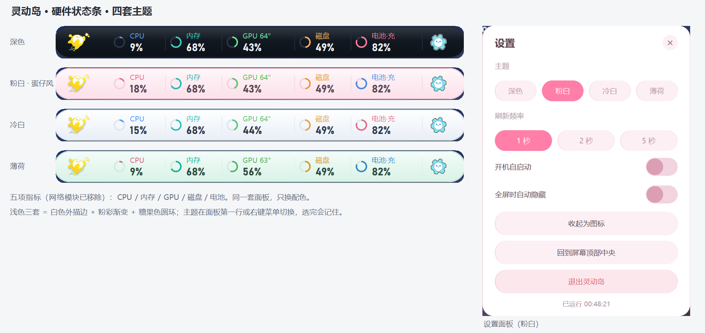
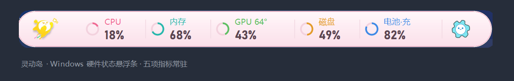
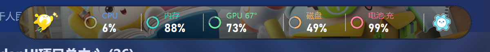

# 灵动岛 · Windows 硬件状态悬浮条

一个贴在屏幕顶部中央的「灵动岛」式硬件监控：一条**细长**的胶囊，CPU / 内存 / GPU / 磁盘 / 电池 / 网络 六项指标一屏全显示，不展开、不收起，每项左边一个小圆环显示占用比例。







- 纯 Python 标准库实现（tkinter + ctypes 直调 Win32 API），**不需要 pip 安装任何包**
- 单文件 `dynamic_island.py`，无后台服务、无网络请求
- 适配高 DPI（按系统缩放自动放大，字不糊）
- 圆环、开关、胶囊圆角都是 4x 超采样位图，边缘平滑没有锯齿
- 左端是蛋仔宇航员头像贴纸、右端是蛋仔风齿轮贴纸，都来自用户提供的原图（抠底后按 RGBA 封进脚本，不依赖外部图片文件）
- 底色有两种：跟随主题的渐变，或者轮换播放 `轮换图/` 里的图片（原图居中裁剪铺满，默认 25 秒一张）

## 启动

双击 `启动灵动岛.bat`，或者：

```bat
python dynamic_island.py
```

（`启动灵动岛.bat` 会优先用 `pythonw.exe` 启动，所以不会弹出黑色命令行窗口。）

**不想装 Python**：直接下 [Releases](https://github.com/xiaolan-dan/lindong-eggy/releases/latest) 里的 `LingDong-EGGY-v3.3.0.exe`，双击就能跑。单文件、免安装、约 14 MB，首次启动要解包，慢一两秒是正常的。

打包自己改过的版本：

```bat
pip install pyinstaller
打包exe.bat
```

产物在 `dist\灵动岛.exe`，`轮换图/` 会一起打进去。想让 exe 读你自己的图，在 exe 旁边放一个 `轮换图/` 即可 —— 程序优先读外部目录，没有再退回内置的那份。

## 文件结构

| 路径 | 说明 |
| --- | --- |
| `dynamic_island.py` | 全部程序，单文件；图标、小图、圆环位图都以 base64 内嵌，运行时不读外部文件 |
| `轮换图/` | 图片轮换用的 PNG（`01.png` … `16.png`），脚本启动时扫这里；没有这个目录就自动退回渐变底 |
| `启动灵动岛.bat` | 双击启动，按 `pythonw` → `pyw -3` → PATH 里的 `pythonw` 依次找解释器 |
| `打包exe.bat` | 一键用 PyInstaller 打成 `dist\灵动岛.exe`（需要 `pip install pyinstaller`） |
| `预览.png` / `预览-四主题.png` / `预览-图片轮换.png` | 截图与四主题对比图、图片轮换效果图，只用于 README |
| `素材/` | 制作脚本时用的原图备份（程序本身不需要） |
| `素材/轮换原图/` + `素材/make_photos.py` | 轮换图的原始图，以及把它们按胶囊比例裁成 PNG 的生成脚本 |
| `LICENSE` | MIT 许可证 |

## 换一台电脑能跑吗

能，只要那台电脑是 **Windows 10/11 + Python 3.8 以上**（Tk 包含在标准 Python 安装包里）：

- 不依赖任何第三方包，不用 `pip install`
- 所有贴图都 base64 内嵌在 `dynamic_island.py` 里，`素材/` 目录丢了也不影响运行
- 主题配置写在 `%LOCALAPPDATA%\LINDONG-EGGY\config.json`，新机器上第一次跑会用默认深色主题
- 「开机自启动」写的是当前解释器的绝对路径，换机器后重新勾一次即可

注意：`GetSystemTimes`、`GlobalMemoryStatusEx`、PDH 计数器、NVML 都是 Windows 专属接口，**Linux / macOS 跑不了**。

## 交互

| 操作 | 效果 |
| --- | --- |
| 点击右端齿轮 | 打开 / 收起**设置面板**（独立小卡片，浮在胶囊下方，跟随当前主题换色） |
| 右键胶囊 | 快捷菜单：主题、刷新频率（1/2/5 秒）、开机自启、全屏自动隐藏、图片轮换、下一张图片、**打开任务管理器**、收起为图标、退出 |
| 右键小图标 | 从「收起为图标」的状态恢复成长条，并回到屏幕顶部中央 |
| 鼠标悬停胶囊 | 胶囊向下微微「长」出一点（弹簧阻尼 + 轻微过冲，约 0.3 秒到位），六列内容跟着一起下沉居中 |
| 左键按下胶囊 | 内容再往下沉约 2 物理像素，松手弹回；只是手感反馈，不触发任何动作 |

位置固定，**不支持左键拖动**；也没有悬停展开 —— 六项指标始终常驻可见。

## 设置面板

点齿轮后弹出（再点一次收起，按 Esc 或点右上角 × 也能关）：

- **主题**：深色 / 粉白 / 冷白 / 薄荷 四段胶囊，选中那段用主题主色底、白字；一切换长条和面板同时换色，并记到 `%LOCALAPPDATA%\LINDONG-EGGY\config.json`，下次启动自动还原。**轮换模式下这一排会整排变灰并锁死在深色**（照片当底图时，浅色主题的白描边、浅分隔线全都会糊在画面里），退掉轮换会自动还回你原来选的主题
- **刷新频率**：1 秒 / 2 秒 / 5 秒三段胶囊，选中的那段是主题主色底、白字
- **图片轮换**：开关。关掉是主题渐变底，打开就用 `轮换图/` 里的图片当胶囊底（开关状态也会记住）
- **轮换间隔**：10 秒 / 25 秒 / 60 秒三档，换图间隔，选了立刻生效并记进配置
- **开机自启动**：开关，等价于往启动文件夹写 `动态岛硬件状态.vbs`
- **全屏/遮挡时隐藏**：开关，默认开启。开着时，只要岛顶那块区域被任何窗口压住（全屏程序、最大化的浏览器、随手拖到顶部的小窗都算），约 3 秒后胶囊整个藏起，区域重新露出来 1.5 秒内回来。关掉时不再隐藏，而是**降级成「置底」**：胶囊退到所有窗口下面（`HWND_BOTTOM`），窗口怎么叠都盖在它上面，桌面一露出来又回到最上层。全屏判断走两路：先问系统 `SHQueryUserNotificationState`（独占全屏游戏、F11 浏览器、播放器全屏都被它标成「全屏程序」），不成就量顶层窗口是否覆盖所在显示器 ≥95%；另外再从 z 序顶端往下扫，找第一个与胶囊矩形相交 ≥6% 的普通窗口。桌面、任务栏、开始菜单、cloaked UWP、最大化窗口（`IsZoomed`）都不算遮挡。每次翻转都记进 `%LOCALAPPDATA%\LINDONG-EGGY\fs.log`。开关状态记在配置里
- **收起为图标**：把长条换成右上角一枚可以拖来拖去的小图标（右键小图标恢复）
- **退出灵动岛**：关掉整个程序
- 底部一行「已运行 hh:mm:ss」

面板所有控件都是画布自绘（圆角、跑道开关、危险色按钮），点击由面板自己做命中测试，不依赖 Tk 的 canvas tag 绑定 —— 这样底图不会盖住控件导致点不动。

## 自适应与抗锯齿

**尺寸跟着屏幕走**：启动时读屏幕逻辑宽度，胶囊目标宽度取屏宽的 50%（`FIT_RATIO`，六列比五列宽，比例相应放宽），结果夹在 0.75~1.4 倍之间（`FIT_MIN` / `FIT_MAX`），并且绝不超过屏宽 92%。这个系数同时作用在**所有长度和字号**上（`S()` 里统一乘），所以窄屏整体缩小、宽屏整体放大，比例不会崩。当前 2560×1600 @200% 的机器算出来是 1.00（胶囊 1280 物理像素宽），1920 逻辑宽会顶到 1.4 上限，1024 的老设备会缩到 0.83。

**交互动画怎么做的**：窗口高度一次性开到「最大展开态」（`MORPH_GROW` + `MORPH_WIN_PAD`），下面多出来的部分是抠色透明的，鼠标可以直接点穿。动画只做两件事——换成对应高度的底图、把 `body` 标签下的内容整体平移，所以每帧成本 1~3ms，不会掉帧。高度帧和照片素材都在空闲时预渲染（`_morph_prewarm`），第一次悬停也不会卡在渲染上。

**照片轮换时图跟着一起放大**：图片模式下每一帧底图都是拿当前成品图居中取 `1/z` 的取景窗（`z = 当前高度 / 静止高度`）再铺满新高度，所以胶囊长高时照片是等比「放大」，不是被纵向拉长；取景窗本身已经排掉外圈描边，不会把描边色带进画面。单帧约 24ms，16 档全部预渲染约 380ms。

轮换的淡入淡出只在静止高度跑（过渡帧只有那一档高度）；展开状态下换图直接换，避免底图高度和胶囊高度不一致。

**抗锯齿做了这几件事**：

- 胶囊左右圆头：边缘带改用 2×2 子采样算覆盖率（原来按距离近似成 `0.5 - sd`，曲线段会偏硬）
- 圆环：高密度屏（`scale × fit ≥ 1.75`）自动把采样从 4× 提到 6×
- 头像 / 齿轮贴纸：源图只有 56px、44px，上屏要画到 66px、46px，属于**放大**，所以改用双线性插值（缩小时走 2×2 盒式平均），边缘不再有硬台阶
- 圆环轨道、分隔线按 1 物理像素画，不做半像素模糊（做了反而发灰）

## 主题

内置四套配色，右键菜单的「主题」子菜单和设置面板第一行都能切（切完会记住）：

| 主题 | 胶囊 | 风格 |
| --- | --- | --- |
| 深色 | 深蓝黑渐变 | 原来的样子，代码默认 |
| 粉白 | 白→淡粉渐变 | 《蛋仔派对》糖感：白色外描边 + 粉彩 + 糖果色圆环 |
| 冷白 | 白→冷灰蓝渐变 | 干净的白底蓝调 |
| 薄荷 | 白→薄荷绿渐变 | 清爽的白底青绿 |

三套浅色主题都按「白色外描边 + 糖果色」做：胶囊最外 1px 是纯白描边、往里一圈是淡淡的主题色收边、主体是上浅下深的粉彩渐变；圆环、指标名用 6 个糖果色；设置面板是白卡片 + 主题色描边，胶囊描边也加粗到 1.8px，看起来更「贴纸」。

浅色主题的圆环轨道会把 `TRACK` 往正文色压深 30%（`_scene()` 里算），否则环和胶囊底色太接近、整圈看起来「没有边」；同时关掉深色光晕，避免环外圈糊出一圈脏边。深色主题和照片模式维持原样。

加一套新主题：在 `dynamic_island.py` 顶部的 `THEMES` 字典里照着复制一份（改 `label` 和那 20 来个颜色名），再把它的 key 加进 `THEME_ORDER` —— 设置面板的主题行会自动多出一段胶囊（面板按 `len(THEME_ORDER)` 等分宽度）。

## 图片轮换

胶囊的底色除了主题渐变，还可以是图片。

- **用哪张图**：脚本进目录 `轮换图/` 里所有 `.png`，按文件名排序（所以 `01.png`、`02.png`… 就是播放顺序）
- **怎么裁**：胶囊宽高比是 556:44（约 12.6:1），原图按这个比例**居中裁一条**再缩放铺满，不拉伸变形
- **多久换一张**：设置面板「轮换间隔」里有 10 秒 / 25 秒 / 60 秒三档（默认 25 秒），选了立刻生效并记进配置；右键菜单的「下一张图片」可以马上切
- **怎么换**：两张图之间做约 0.32 秒的淡入淡出（逐帧混合）。过渡帧是在两次轮换之间的空档里提前算好的，切图那一刻只是换位图，不会卡；如果刚启动还没算完，就直接硬切，不拖慢界面
- **为什么带压暗**：照片比渐变亮得多，所以底图上盖了一层上浅下深的暗色遮罩（`PHOTO_SCRIM_TOP` / `PHOTO_SCRIM_BOTTOM`），同时读数、分隔线在图片模式下自动转白，指标名仍用主题强调色
- **图标怎么办**：头像、齿轮、圆环都改成了带透明通道的 RGBA 位图，可以直接压在照片上；圆环在图片模式下换成半透明白轨道 + 深色光晕，避免在花花绿绿的画面上糊掉
- **主题为什么变深色**：照片模式下主题锁死在「深色」。浅色主题的白描边、浅灰分隔线、白卡片压在照片上几乎看不见，强制深色是唯一能保证读数清楚的选择；打开轮换时自动切过去，关掉轮换会把你原来的主题还回来

放新图进去只要两步：把图裁成 12.6:1 左右的横条、存成 PNG 放进 `轮换图/`（Tk 只认 PNG/GIF，**JPG 放进去不会显示**）。批量重新生成就用 `素材/make_photos.py`：把原图丢进 `素材/轮换原图/`，跑一遍脚本，它按 556:44 居中裁好、缩到 1200px 宽，依次写成 `轮换图/01.png`、`02.png`…

```bat
python 素材\make_photos.py
```

没有 `轮换图/` 目录、或目录里没有 PNG 时，程序照常运行，只是退回主题渐变底（右键菜单的「图片轮换」开关也会自动关掉）。

## 显示内容

从左到右六列，每列结构都是「小圆环 + 指标名 + 数值」：

| 列 | 圆环含义 | 数值 |
| --- | --- | --- |
| CPU | 整体占用率 | 百分比 |
| 内存 | 物理内存占用率 | 百分比 |
| GPU | 显卡利用率 | 百分比，低于 10% 时保留一位小数（闲置时不会一律显示 0%），指标名旁边带温度（NVIDIA 可读） |
| 磁盘 | 所有固定磁盘的总占用率 | 百分比 |
| 电池 | 电量 | 百分比，充电时指标名显示「电池·充」 |
| 网络 | 实时吞吐（2 MB/s 满格） | `↓下载 ↑上传`，例如 `↓1.2M ↑85K`；一块可用网卡都没有时整列转红显示「断网」 |

最左边是蛋仔宇航员头像，会随 CPU 负载轻微换色：正常（原色）→ 65%~85% 偏橙 → >85% 偏红。最右边是齿轮快捷入口，鼠标移上去会变亮并变成手型光标。

## 数据是怎么来的

全部走系统原生接口，1 秒采样一次（独立线程，不卡界面），开销可以忽略（实测常驻 CPU 0.4%、内存约 110 MB，大头是内嵌贴纸位图）：

- **CPU**：`GetSystemTimes` 两次差值算占用率；名称与主频读注册表 `CentralProcessor\0`
- **内存**：`GlobalMemoryStatusEx`
- **磁盘**：枚举固定分区后 `GetDiskFreeSpaceExW` 累加
- **GPU 利用率**：PDH 性能计数器 `\GPU Engine(*)\Utilization Percentage`；同一块显卡每个进程各占一条计数器，所以按引擎类型（3D / Copy / VideoDecode…）跨进程求和、再取各引擎最大值，口径接近任务管理器，NVIDIA / AMD / Intel 通用
- **GPU 温度**：NVML（`nvml.dll`，随 NVIDIA 驱动安装）；A 卡 / 核显无公开接口，温度不显示
- **电池**：`GetSystemPowerStatus`
- **网络**：`GetIfTable` 读各网卡的累计收发字节，两次采样做差得实时速率；同一块网卡会被系统拆成多条记录（计数器相同），所以先按网卡描述归并再求和，避免把流量乘好几倍；隧道/环回适配器直接排除
- **运行时长**：`GetTickCount64`（设置面板与右键菜单里显示）

## 常见问题

**条悬在任务栏 / 别人窗口上面**
「全屏/遮挡时隐藏」默认就是开的：只要胶囊那块区域被压住——全屏游戏、F11 浏览器、无边框全屏视频、最大化的浏览器、随手拖到屏幕顶部的小窗——约 3 秒后胶囊整个藏起，区域露出来 1.5 秒内自动回来。把开关关掉后不再隐藏，改成**置底**：胶囊退到所有窗口最下面，谁都能盖住它，桌面露出来才回到最上层。要是还遇到该藏没藏，看 `%LOCALAPPDATA%\LINDONG-EGGY\fs.log`——每次藏/显示/置底都会写一行，含判断依据、窗口类名、矩形、覆盖面积和系统通知状态；行尾带 `[switch off]` 或出现 `switch -> off` 就说明是开关本身被关了，不是检测没命中。

**双击启动没反应 / 提示「已经在运行」**
程序是单实例的：已经有份灵动岛在跑时，再启动会弹一句提示然后退出，不会叠出第二条胶囊。要换新版就先右键旧的「退出灵动岛」再开。

**显卡温度不显示**
只有 NVIDIA 显卡能通过驱动接口读到温度，AMD / Intel 核显暂不支持，其它指标照常显示。

**窗口最外圈有一点深色描边**
窗口用「颜色键抠图」做透明，圆角最外一层像素为了抗锯齿要往抠色（纯黑）过渡，看起来像一道很细的暗边。这是不依赖 Pillow 做逐像素透明窗口的取舍；想要完全干净的无边缘，得改成 Win32 分层窗口自己渲染整块界面。

**想挪动位置 / 想恢复默认位置**
左键拖动已禁用，位置固定（默认贴屏幕顶部居中，6px 上边距）。

**面板第一次点开会顿一下**
首次打开要现场渲染整块 300×502 的圆角卡片，之后所有位图走缓存（启动时会预热一批），随后再打开、切换设置项的重绘都是毫秒级。如果嫌首次慢，可以把 `make_round_image()` 里的 `SS`（超采样倍数）从 4 降到 2。

**想改配色或尺寸**
打开 `dynamic_island.py` 顶部：

- 配色：都集中在顶部 `THEMES` 字典里，一套主题一个 key（`ACC` 是五种指标的强调色，`BG_TOP` / `BG_BOTTOM` 是胶囊渐变，`BORDER` / `BORDER_DEEP` 是描边，`TEXT` 是数值颜色，`CARD_*` / `ITEM_*` / `ACTIVE_BG` / `DANGER_*` 是设置面板的配色，`EDGE_W` 是胶囊描边粗细）。加主题见上面「主题」一节，不要再单独去改 `SettingsPanel` 的类属性 —— 那些会被 `apply_theme()` 覆盖
- 尺寸：`STRIP_H` 是胶囊高度（44，改大就变粗），`PAD_L` / `PAD_R` / `COL_GAP` 是留白与列间距，`COLUMNS` 里每列第三个数字是列宽，`GEAR_W` / `GEAR_D` 是右端齿轮的占位宽度与图标直径；总长度由这些自动求和（`STRIP_W`），别再单独写死
- 圆环大小：`_build()` 里的 `self.S(16)` 是圆环直径、`self.S(2)` 是环宽
- 自适应与动画：`FIT_RATIO` 是胶囊占屏宽的比例、`FIT_MIN` / `FIT_MAX` 是缩放上下限；`MORPH_GROW` 是悬停时长出的逻辑高度、`MORPH_WIN_PAD` 是窗口额外留白；`SPRING_K` / `SPRING_D` 是弹簧刚度与阻尼（`K` 大更快、`D` 大更不弹）、`PRESS_DIP` 是按下时内容下沉量
- 图片轮换：`PHOTO_DIR` 是素材目录名（默认 `轮换图`）；`PHOTO_INTERVAL` 是默认间隔秒数（面板里可改，改完存配置）；`PHOTO_FADE_MS` / `PHOTO_FADE_STEPS` 是淡入淡出时长与帧数（帧数越多越顺，每帧多算一次 60ms 左右的混合）；`PHOTO_SCRIM_TOP` / `PHOTO_SCRIM_BOTTOM` 是顶部 / 底部压暗强度（0 不压、1 全黑）
- 齿轮图标：`GEAR_STICKER_B64` 是一张 44×44 的 RGBA 位图（原图贴纸抠掉黑底后按面积平均缩小），base64 直接内嵌在脚本里；想换图就把新图同样处理成 44×44 RGBA base64 替换即可
- 左侧头像：`AVATAR_B64` 是一张 56×56 的 RGBA 位图（直接用原图自带的 alpha 通道取内容 bbox → 居中补方 → 面积平均降到 56×56），`AVATAR_PX` 是位图边长、`AVATAR_D` 是上屏后的显示直径、`AVATAR_CX` 是头像圆心的横坐标，`AVATAR_TINTS` 是 CPU 负载升高时的三档色偏

**头像 / 齿轮怎么重做一张**
用原图的 **alpha 通道**取 bbox（不要按白底洪水填充抠色，那会把贴纸里的浅色描边也吃掉），再按面积平均降采样，最后回读校验 base64 是否一致。齿轮原图是黑底 JPEG、没有 alpha，才走「按黑抠 + 边框洪水填充」这条路。

## 素材

`素材/` 放的是这些图标和贴图的**原图备份**（程序本身用不到，图片都已 base64 内嵌在脚本里）：

| 文件 | 说明 |
| --- | --- |
| `蛋仔头像-原图.png` | 长条左端吉祥物（原图自带透明通道 128×111） |
| `蛋仔齿轮贴纸-原图.jpeg` | 右端设置入口，黑底贴纸 256×256 |
| `豆包派对横幅-粉底-原图.png` | 收起小图用的横幅，你改过粉色背景的版本 2656×832 |
| `豆包派对横幅-白底-原图.png` | 同一张的白底版，留档 |
| `收起小图-抠粉透明版.png` | 抠掉粉色后的成品 430×112，脚本里内嵌的就是它 |
| `轮换原图/` | 图片轮换的 16 张原图（玩家提供的《蛋仔派对》宣传图），`make_photos.py` 的输入 |
| `make_photos.py` | 把 `轮换原图/` 按 556:44 居中裁剪、缩到 1200px 宽，输出 `轮换图/01.png…` 的生成脚本 |

**开机自启**
设置面板或右键菜单勾选「开机自启动」，会在启动文件夹里写一个 `动态岛硬件状态.vbs`（用 `pythonw` 静默拉起）。取消勾选即删除。

## 版权说明

- 代码（`dynamic_island.py`、`启动灵动岛.bat`、README 等）按 **MIT** 许可发布，见 `LICENSE`。
- `素材/` 里的蛋仔头像、齿轮贴纸、派对横幅原图来自《蛋仔派对》，**版权归网易所有**，这里仅作为个人学习与界面风格的参考素材收录。若你要二次分发或商用，请自行替换成自己拥有版权的图片（脚本里对应的 base64 常量换成新图即可）。
- `轮换图/` 与 `素材/轮换原图/` 里的宣传图同样来自《蛋仔派对》，**版权归网易所有**，只在本机当桌面挂件用；分发仓库时请把 `轮换图/` 换成你自己的图（程序会自动读取，不需要改代码）。
- 程序与网易、字节跳动均无关联，是一个独立的个人开源项目。
- 内容由豆包ai生成，代码版权归个人。

## 许可证

[MIT](LICENSE) © 2026 LINDONG-EGGY
